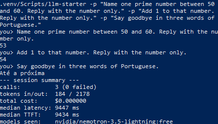

# llm-starter

A terminal chat CLI for [OpenRouter](https://openrouter.ai): streaming answers, model fallbacks from `.env`, and a JSONL log of every call with the model that actually answered, tokens, cost and latency.

Day 1 of a 56-day series of small public AI projects. Calling an LLM takes a few lines; knowing which model answered, what it cost and how long it took is what you need once it runs for real. This project keeps that accounting small enough to read in one sitting, with two runtime dependencies and no framework.

## Demo



Real `make demo` output from 2026-11-06. The second prompt only works because the session keeps its history:

```console
$ make demo
you> Name one prime number between 50 and 60. Reply with the number only.
53
you> Add 1 to that number. Reply with the number only.
54
you> Say goodbye in three words of Portuguese.
Até a próxima
--- session summary ---
calls:          3 (0 failed)
tokens in/out:  184 / 2178
total cost:     $0.000000
median latency: 9447 ms
median TTFT:    9434 ms
models seen:    nvidia/nemotron-3.5-lightning:free
```

Listing free models needs no key. Real output from 2026-11-06 (the list changes often):

```console
$ llm-starter models --free
cohere/north-mini-code:free
dots-studio/dots-3-note-preview:free
google/gemma-4-26b-a4b-it:free
google/gemma-4-31b-it:free
liquid/lfm-2.5-2.6b:free
nvidia/nemotron-3-nano-omni-30b-a3b-reasoning:free
nvidia/nemotron-3-ultra-550b-a55b:free
nvidia/nemotron-3.5-lightning:free
nvidia/nemotron-3.5-super-vl:free
recursive/flint-v1.0:free
xingchen-agi/xing4.0-29b-a4b:free
```

## Quickstart

Requires Python 3.11+ and GNU Make (on Windows: `winget install ezwinports.make`).

```bash
cp .env.example .env    # then set OPENROUTER_API_KEY and MODEL_PRIMARY
make setup run
```

To pick `MODEL_PRIMARY`, run `make setup`, then `.venv/bin/llm-starter models --free` (`.venv\Scripts\llm-starter` on Windows).

| Variable | Required | Meaning |
| --- | --- | --- |
| `OPENROUTER_API_KEY` | yes | Your OpenRouter key |
| `MODEL_PRIMARY` | yes | Model id to request |
| `MODEL_FALLBACKS` | no | Comma-separated model ids to try if the primary fails |
| `LLM_LOG_PATH` | no | Usage log path, default `logs/usage.jsonl` |

Settings come from the environment or from `.env` in the working directory. Real environment variables win.

## Commands

```text
llm-starter                    chat REPL
llm-starter -p "text"          run one prompt and exit
llm-starter -p "a" -p "b"      run several prompts in order, in one session
llm-starter models [--free]    list model ids (no API key needed)
```

Inside the REPL:

| Command | Action |
| --- | --- |
| `/model` (`/modelo`) | Show the current primary model and fallbacks |
| `/model <id>` | Switch the primary model for this session; fallbacks stay the same |
| `/cost` (`/custo`) | Session summary: calls, tokens in/out, total cost, median latency and TTFT, models seen |
| `/clear` | Forget the conversation history |
| `/help` | List commands |
| `/quit` or Ctrl-D | Exit and print the session summary |
| Ctrl-C | Cancel the answer being streamed; the session continues |

On Windows, press Enter after Ctrl-D (or use Ctrl-Z and Enter).

With `-p`, the exit code is 1 if any prompt failed. A failed prompt does not stop the ones after it.

Make targets: `setup`, `run`, `test`, `lint`, `demo`.

## How it works

The code uses the OpenAI SDK pointed at `https://openrouter.ai/api/v1`.

```text
cli.py        entry point: REPL, -p, models
chat.py       history, slash commands, model switching
client.py     streaming call + fallbacks + usage -> CallResult
usage_log.py  JSONL append + session stats
config.py     env -> Settings
```

**Fallbacks.** `MODEL_PRIMARY` goes in `model` and `MODEL_FALLBACKS` in the `models` request field. OpenRouter does the failover on its side, so the client makes one request either way. `chunk.model` says who answered, and the log keeps that next to `requested_model`.

**Usage accounting.** OpenRouter sends usage in the last SSE chunk, which may have empty `choices`, so text and usage are read independently. Cost is whatever the API reports: if it is missing, the log says `null` and `/cost` says so. Prices are never estimated.

**Timing.** Both are measured with `time.perf_counter()` from the start of the request. TTFT stops at the first non-empty content delta; latency stops when the stream ends.

**Errors.** 401, 402, 429, other HTTP errors, network failures and errors sent mid-stream each print one line with the status, are logged with `ok=false`, and leave the session running. Failed or cancelled turns are not added to the history, so the next request starts from the last complete exchange. The SDK's automatic retries are turned off: they would hide calls from the log and spend free-tier quota.

### Log schema

One JSON object per line, appended after every call, including failed and cancelled ones. Prompt and response text are never logged.

| Field | Type | Meaning |
| --- | --- | --- |
| `ts` | string | Request start, UTC ISO-8601 |
| `requested_model` | string | Primary model at the time of the call |
| `model` | string or null | Model that actually answered |
| `prompt_tokens` | int or null | Input tokens |
| `completion_tokens` | int or null | Output tokens |
| `total_tokens` | int or null | Input plus output |
| `cost` | number or null | Cost in credits, as reported by OpenRouter |
| `ttft_ms` | number or null | Time to first token |
| `latency_ms` | number | Time until the stream ended |
| `finish_reason` | string or null | For example `stop` or `length` |
| `ok` | bool | Whether the call completed |
| `error` | string or null | One-line error, or `cancelled by user` |

## Results

One `make demo` run on 2026-11-06, with free models:

| Metric | Value |
| --- | --- |
| Model requested | `google/gemma-4-31b-it:free` |
| Model that answered | `nvidia/nemotron-3.5-lightning:free` (the fallback) |
| Calls | 3 (0 failed) |
| Median latency | 9,447 ms |
| Median TTFT | 9,434 ms |
| Total cost | $0.000000 |

All three calls were served by the fallback, which is what the `requested_model` and `model` fields exist to show. The summary alone would not reveal it was a fallback; the log does.

TTFT is almost the whole latency, and the three short answers used 2,178 completion tokens. That pattern fits a model that reasons before it writes visible text. This is a single run on a free tier, so treat it as an example rather than a benchmark.

## Limits

- **Free models.** A `:free` model that falls back to a paid one is billed as the paid one. Free-tier limits are 20 requests/minute, plus 50 requests/day with fewer than 10 credits purchased or 1,000/day from 10 credits. A negative balance returns 402 even on free models.
- **No retries.** A 429 or a network error is reported and left to you. Backoff is planned for a later day.
- **Cancelled calls have no usage data.** Usage arrives in the last chunk, so a cancelled answer logs `null` tokens and cost even though the provider may bill what it generated.
- **Only `content` deltas are shown.** Anything a model generates before its visible text is not printed, so the terminal stays quiet during that time, while TTFT and `completion_tokens` still reflect it.
- **Medians cover successful calls only.** Failed calls are counted in `/cost` but would otherwise skew latency down.
- **Ctrl-C on Windows** takes effect when the next bytes arrive, so it can lag while a stream is silent. It is immediate while tokens are flowing.
- **`/model <id>` is not validated locally.** A wrong id comes back as an API error, and the session continues.
- **History is in memory** and grows until `/clear`; nothing trims it to the model's context window.

## Development

```bash
make test    # no network or API key needed
make lint
```

CI runs ruff and pytest on Python 3.12 for every push and pull request.

## License

[MIT](LICENSE)
